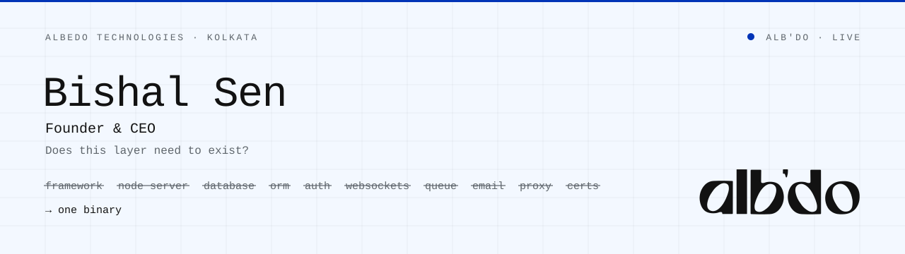

<picture>
  <source media="(prefers-color-scheme: dark)" srcset="assets/banner-light.svg">
  
</picture>

### Bishal Sen &nbsp;·&nbsp; Founder & CEO, [ALBEDO Technologies](https://albedotechnologies.dev)

I build **[ALB'DO](https://github.com/Sen-Bishal/AlB-DO)**, infrastructure that compiles a web application into one executable. Pages, database, sign-in, roles, live data, jobs, email, uploads and HTTPS ship in a single binary, with no Node.js in the request path.

The method is one question, asked of every layer: *does this need to exist?* When the answer is no, ALB'DO derives what that layer was told from the code and removes the layer.

**ALB'DO is live and running in production for its first customers.**

---

#### What one binary replaces

| You normally run | In ALB'DO |
| :--- | :--- |
| A meta-framework and a Node server | A Rust compiler and runtime. It decides, per component, how much JavaScript reaches the browser, and often that is none. |
| A database, an ORM and a migrations folder | **FORGE**: you declare collections, and the compiler emits the tables, queries, live channels and types. |
| WebSocket code and a pub/sub service | **PHOSPHOR** and **PRISM**: one connection per browser. A change goes over the wire as the row that changed. |
| An auth provider and access policies | Built-in sign-in and **POLARIZER** roles, checked on every page, action and live read. |
| A proxy, a certificate manager and a rate limiter | HTTPS from Let's Encrypt inside the binary, plus **SHUTTER** budgets derived from what each endpoint does. |
| Trust in whatever server code does | **SANDGATE**: server code runs with no ambient authority. **APERTURE** journals every outbound call and refuses private addresses. |

#### Measured

Every figure below lists its conditions and the date it was measured.

| Measured | Result | Conditions | Date |
| :--- | ---: | :--- | :--- |
| npm dependencies at run time | **58 MB → 1.3 MB** | a five-dependency app | 2026-09-03 |
| Live database-backed route vs. a route with no data | **+3%** | 2,564 vs. 2,654 req/s, same machine | 2026-09-04 |
| Middleware overhead per request, median | **27 µs** | pooled engine | 2026-09-13 |
| Clean shutdown on SIGTERM with live streams open | **265 ms** | in a container | 2026-09 |
| First start to an issued HTTPS certificate | **13 s** | Let's Encrypt, no proxy | 2026-11-12 |

---

#### Where I work

**Compilers and static analysis** (deriving at build time what frameworks make developers declare) · **runtimes and concurrency** (lock-free scheduling, SIMD, zero-allocation hot paths) · **data systems** (embedded storage, incremental projection, live replication) · **confinement** (capability-based sandboxing for code you didn't write).

**Rust** &nbsp;·&nbsp; **C++** &nbsp;·&nbsp; **Go**

#### Next

ALB'DO is where we started. At ALBEDO Technologies we're taking the same question further down the stack, to networks, to hardware that runs unattended, and to leading-edge silicon designed in India.

---

Kolkata, India &nbsp;·&nbsp; <a href="https://albedotechnologies.dev">albedotechnologies.dev</a> &nbsp;·&nbsp; <a href="https://github.com/Sen-Bishal/AlB-DO">ALB'DO on GitHub</a>
